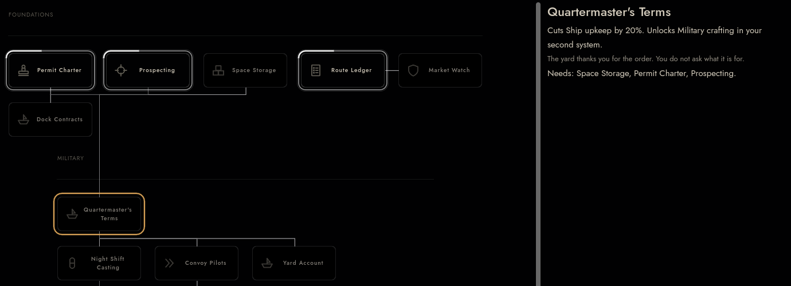

# Assignment #7: Complete AI Dev Pipeline

## ▶ Play now: https://star-bazaar-beta.vercel.app

No install and no account needed.

1. Open the link in a desktop browser (Chrome, Edge, Firefox or Safari with WebGL 2). The first load downloads about 90 MB and takes 10 to 30 seconds.
2. On the main menu click **New Game**. Type a company name (or press **Random**), pick one of the four CEO portraits and press **Start**.
3. Read the short preface. The game then starts paused and a guided tutorial walks you through the first steps: pick a world, place a **Buy** order, **Send to...** another world, run a cycle.
4. Controls are mouse only. **P** pauses. The speed buttons (1x, 2x, 6x, 12x) set how fast cycles run.

Saves are kept in your browser.

---

## Student & game overview

| | |
|---|---|
| **Student name** | Ivan Larinin |
| **Capstone game title** | Star Bazaar |
| **Game concept brief** | A single-player space trading game made in Godot 4. You run a trading company, not a single freighter. Ships fly automated routes between worlds; you decide where to invest (routes, ships, workshops, permits for new solar systems, skills). Worlds you supply grow through Prosperity tiers. The goal is to found the Star Bazaar in a system's Space Storage, build it stage by stage and open it with a final charter delivery before the term ends. Three trading houses act as "weather" (floods, shortages, congestion), not rivals. |

## Deliverable 1: Playable link

**Playable game link:** https://star-bazaar-beta.vercel.app

The web build is a Godot 4.7.2 HTML5 export hosted on Vercel. Its source is the `web-build` branch, folder `web/`.

## Deliverable 2: Pipeline source code & engine integration

**Pipeline repository:** https://github.com/Veltrynox/star-bazaar

**Pipeline run video:** https://youtu.be/YBdCzB4Mqtw

### Integration breakdown

**Target game engine:** Godot 4.7 (GDScript), exported to WebGL 2 / WebAssembly for the browser.

**Automated flow description:**

The pipeline is a team of Claude Code role agents, each defined in `.claude/agents/*.md`: gameplay, UI, FX, juice and galaxy programmers, a story designer, an economy designer and a feature designer. Work is queued as tasks in `schedule.json`. Agents hand work to each other through files: `handoffs/`, `blackboard.md` and `design/proposals/`.

Agent output lands in the engine through fixed file formats, so nothing is reformatted by hand:

- **Story and UI text.** The story-designer agent writes plain Markdown blocks in `story/*.md` (`ID | max length | place`, then the text). `tools/build_story.py` is the only writer of `data/story_text.json`, `data/events.json` and `data/story_text_ru.json`. It checks for duplicate ids and length limits and stamps each file with a `generated` marker. The game loads these JSON files at runtime (`game/story_text.gd`, `game/events.gd`, `game/lang.gd`), so a new event or line shows up in the game with no code change.
- **Translation.** Haiku agents write `story/ru/*.json` (`{"ID": "text"}`) under `story/ru/GLOSSARY.md`. The same build step merges them into `data/story_text_ru.json`, and the in-game language switch picks them up.
- **Game data.** The economy-designer agent edits `data/*.json` (balance, goods, ships, skills, chains, gigs). Game code reads numbers only from these files. The design document `gdd.md` holds no numbers.
- **Code.** Programmer agents write GDScript in `game/` directly. A commit hook (`tools/gdd_sync.py`) blocks any commit that changes `game/`, `data/` or `story/` without updating `gdd.md`, so the design document stays in step with the build.
- **Generated art and audio.** Tool scripts produce engine-ready files: texture atlases (`tools/make_*_atlas.gd`, run in headless Godot), planet textures (`tools/planet_texture_gen.gd`), icons and UI (`tools/make_icons.py`, `tools/make_skill_icons.py`, `tools/make_ui.py`) and the looping space ambience (`tools/make_ambient.py`). Godot imports them like any other asset.
- **Unattended runs.** `tools/orchestrator.py run` picks ready tasks from `schedule.json`, starts one headless `claude -p "/overnight-worker <id>"` per task in its own git worktree, then rebases, runs the test suite and fast-forward merges each finished task. It records the result on `blackboard.md`. Rebase conflicts go to a `merge-resolver` agent.
- **Build.** A headless Godot export (`--export-release "Web" web/index.html`) produces the browser build, and `vercel --prod` publishes it.

**Manual steps between agent output and the engine: none.** No one copies, converts or reformats agent output by hand. Every format step above is a script or a runtime loader. The manual steps listed in Deliverable 3 are human control points (approval, review, QA, conflicts) and the release, not format work.

### Traceability example: one skill from task to screen

The Military skill **Quartermaster's Terms** (text ids `SK_MIL_1_NAME`, `SK_MIL_1_FLAVOUR`), followed from the task to the running game:

| Step | Evidence |
|---|---|
| Task | `T242` in `schedule.json`, "Skills: 15/10 branch identity, emotionally heavy wording", `owner_agent: story-designer` |
| Agent run | story-designer subagent `agent-afe2392580785558b` ("T242 skill wording rewrite"), Sonnet 5.5, 2026-11-06 16:39 UTC, 7 model calls, $0.222. It is listed in `reports/cost_2026-11-25.csv` under that session file. |
| Agent output | `story/skills.md`, lines 29 to 30: `SK_MIL_1_NAME \| 24 \| Skill screen, node name \| Quartermaster's Terms` and the flavour line "The yard thanks you for the order. You do not ask what it is for." |
| Handoff | `handoffs/story-designer/2026-11-05-T242.json` (status done, 31 skill names and flavours rewritten, open questions for the owner) |
| Commit | [`a6199564`](https://github.com/Veltrynox/star-bazaar/commit/a6199564b51133c6358de645527f2a742e33a40e) "T242: skill names and flavour rewritten per branch", 2026-11-06 11:39 (UTC−5), the same minute the agent run ended. The lines are unchanged since (`git blame story/skills.md -L 29,30`). |
| Engine data | `python3 tools/build_story.py` writes the ids into `data/story_text.json` (`"id": "SK_MIL_1_NAME", "text": "Quartermaster's Terms"`) |
| In game | `game/skill_screen.gd` reads the ids at runtime. Screenshot: [`media/docs/trace_SK_MIL_1_in_game.png`](media/docs/trace_SK_MIL_1_in_game.png) shows the node and the detail panel with the same name and flavour line. |

## Deliverable 3: Pipeline audit & cost analysis

### Pipeline production & functionality

**What did the pipeline produce?** Everything below is in the playable build.

- **Text:** 3,172 English text ids in `data/story_text.json` and 2,961 Russian ones in `data/story_text_ru.json`. They cover event titles and bodies, choice buttons and effect lines, gig stories, endings, skill names and descriptions, the tutorial, tips and all UI labels.
- **Narrative content:** 25 base events plus 63 new chain events and 40 chain steps (`data/chains.json`), 7 gigs (story missions, `data/gigs.json`), a 70-node skill tree (`data/skills.json`), and end-of-run scenes told as a story (`game/end_story.gd`, ending scene kits in `story/endings.md`).
- **Economy:** 22 goods and 5 workshops (`data/goods.json`), plus the balance tables for prices, upkeep, Prosperity growth and the Star Bazaar stage bills (`data/balance.json`, `data/prosperity.json`, `data/bazaar.json`).
- **Game code:** 89 GDScript files with about 32,000 lines in `game/`. They cover the trading loop, automated routes, Prosperity, the Star Bazaar, events, the tutorial, the UI panels, planet shaders and FX, and juice animations.
- **Generated assets:** planet surface banner, portrait and skill icon atlases, UI icons and the space ambience audio track.
- **Process output:** 264 scheduled tasks, 261 of them done. Over the course there were 1,014 commits, and 84 tasks went through the unattended orchestrator (73 merged automatically, 11 blocked for a human).

**What manual steps remain?** None of them is a format or integration step: agent output reaches the engine with no manual reformatting (see Integration breakdown). The five below are control and release steps.

1. **Owner approval of designs.** By project rule, design and proposal tasks produce a proposal only. The owner approves it before any agent builds it.
2. **Visual review.** The owner looks at every visual result in the running game. Agents only take a single screenshot for objective breakage, such as a blank or clipped screen.
3. **QA and balance runs are started by hand.** The QA bots (`qa/check`) and the economy designer's retunes are started only by the owner.
4. **Blocked merges.** 11 of the 84 orchestrator tasks stopped on a test failure or a rebase conflict the resolver could not settle, and needed a human.
5. **Release.** Committing, pushing, the web export and the Vercel deploy are still started by hand.

**What would it take to eliminate them?**

- **Approvals and visual review:** a scored acceptance gate in place of a person. For example, an evaluator agent with a written rubric plus screenshot diff checks against approved reference images. The owner would sample results instead of reviewing every one.
- **QA and balance:** run `qa/check` in CI on every merge to `main`, with fixed thresholds for win time, dominant strategy and softlocks. A threshold breach would open a task for the economy designer automatically.
- **Blocked merges:** smaller tasks with non-overlapping `touches` globs, and a retry loop that rebuilds the task on fresh `main` before handing it to a human.
- **Release:** a CI job (for example GitHub Actions with Godot headless) that exports the web build and deploys it to Vercel on every push to `main`.

### Architectural reflection

**Current architectural decision to change:** most work ran from one long-lived interactive main session on a large model. That session read files, briefed role agents, checked their output and committed. Its context grew for hours and was rewritten into the prompt cache again and again. Interactive sessions and the subagents they started cost $776.77 of the $818.54 counted (95%). The unattended orchestrator workers cost $41.77 for all their tasks, about $0.50 per task.

**Specific alternative:** make the orchestrator the default path, not the exception.

- `schedule.json` becomes the only way work enters the pipeline.
- `tools/orchestrator.py` starts a fresh, short-lived headless worker per task on Sonnet (Haiku for translation and text checks), with only that task's brief and the files its `touches` globs name.
- The interactive session is kept for owner conversations and for writing task briefs. It never does the build work itself.
- Each worker ends with a structured result line and a handoff file, so no session needs a growing context.

### Cost analysis

How the cost was measured: `tools/cost_report.py` reads every Claude Code session log of this project and its orchestrator worktrees, takes the `usage` block of each model call (each message id once), and prices it at Anthropic API list rates per model. Input, output, 5-minute and 1-hour cache writes and cache reads are each priced at their own rate. The rates are in the script and in the report.

**Evidence in the repo:** the script `tools/cost_report.py`, its summary `reports/cost_2026-11-25.json` (totals, by model, by token kind, by pipeline part, by role agent, the translation before/after runs) and `reports/cost_2026-11-25.csv` (all 26,192 priced calls: time, model, agent, session file, message id, the four token counts and the dollar cost). Rerun: `python3 tools/cost_report.py`.

**Log retention:** Claude Code deletes session logs after 30 days. The first count, on 2026-11-25, still had the sessions of 2026-10-24 to 10-27 and gave $841.07. When the script was committed on 2026-11-27 the oldest log left was from 2026-10-28, so the figures below ($818.54) are $22.53 lower. The CSV keeps every priced call, so the figures no longer depend on the logs. Work done in Codex (some Russian drafts and the text style-agent run) is not included.

| | |
|---|---|
| **Out-of-pocket cost** | **$200.** Claude subscription, paid per year. It covered all the usage below. |
| **Total actual run cost (API-equivalent)** | **$818.54** for 2026-10-28 to 2026-11-25, from 26,192 model calls (about $28 per day). $841.07 with the four earlier days whose logs are now deleted. |
| By model | Sonnet 5.5 $406.35 · Opus 5.5 $265.54 · Fable 5.1 $84.17 · Fable 5.2 $49.90 · Haiku 5.5 $12.58 |
| By kind of token | cache writes $324.13 (40%) · cache reads $278.25 (34%) · output $216.00 (26%) · uncached input $0.16 |
| By part of the pipeline | interactive main sessions $473.05 · role agents started from them $303.72 · orchestrator workers $41.77 |

**Most expensive pipeline step:** the interactive main session that orchestrated agents cost $473.05 (58%). Most of that was re-sending and re-caching its long context, not producing output. Among the role agents, the **gameplay-programmer** cost the most: $98.85 over 204 runs, all on Sonnet 5.5. The ui-programmer ($45.29) and the story-designer ($36.49) came next.

**Solo/small-team sustainability:** **yes, on a subscription.** A $200 flat fee covered work that would have cost about $820 to $840 at API rates. That's about 260 finished tasks and a playable game in about a month. On pay-as-you-go API billing, about $800 a month is still affordable for a small team. But 95% of it went to the expensive interactive style of work. The orchestrator path cost about $0.50 per task, and the Haiku translation path cost a few cents per batch. Moving the build work to short headless workers (see Architectural reflection) would bring the API cost down to the low hundreds per month.

### Mid-project cost-reduction change

On 2026-11-09 the owner made a rule: all translation is done by agents on the Haiku model, each working from one shared brief and glossary. Before that, translation ran on the story-designer agent with Sonnet. The same job, translating the four market event chains (Military, Luxury, Minerals, Biotech) into Russian, was run both ways.

| | Before (2026-11-04) | After (2026-11-14) |
|---|---|---|
| **Strategy / prompting approach** | One Sonnet 5.5 story-designer agent per chain (4 runs). Each run re-read `CLAUDE.md`, `story/voice.md` and the full glossary before translating. | Haiku 5.5 agents, two chains per run (2 runs), with one hand-written-translation brief plus `story/ru/GLOSSARY.md`. Scripts may only look things up, never write text. |
| **Output tokens** | 71,431 | 72,089 (same amount of text) |
| **Token / API cost** | **$1.206** | **$0.074** (−94%) |

Source: `reports/cost_2026-11-25.json`, key `translation_before_after`, which lists each of the six agent runs (session file, description, model, calls, output tokens, cost). The script matches them by their agent description (translating one of the four market chains) and model.

Across the whole Russian localisation, the 2026-11-10 pass used 25 Haiku story-designer agents (translate, repair and verify chunks) for $0.84 in total, each costing under $0.07 (rows of 2026-11-10 with agent `story-designer` and model `claude-haiku-5-5` in the CSV). Each Sonnet group run it replaced cost $0.31 to $0.61.
