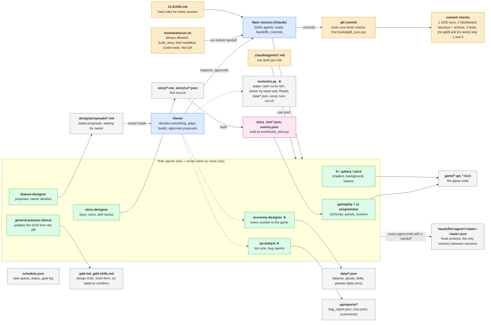

<!-- GENERATED by tools/build_readme.py from tools/readme_intro.md, tools/project_workflow.html and .claude/agents/*.md. Do not edit by hand: change the source and run `python3 tools/build_readme.py`. -->

# Star Bazaar

A single-player space trading game for macOS, made in Godot 4 (GDScript). You run a trading company, not a freighter: ships fly automated routes and you decide where to invest. The goal is to hold more than half of one of four markets (Military, Luxury, Minerals, Biotech) against three rival companies. Design truth: [gdd.md](gdd.md). Working rules: [CLAUDE.md](CLAUDE.md).

## Run and test

- Tests (headless): `sh tools/tests/run.sh`
- Windowed playthrough or screenshots: `qa/run_game.sh res://qa/bots/<script>.gd`
- Godot lives in `tools/godot/Godot.app` (not in git). Never prefix these commands with `cd &&` or `HOME=`.

## How the work flows

Agents keep no memory between sessions, so everything passes through files. Interactive version: [tools/project_workflow.html](tools/project_workflow.html) (open it in a browser).

## Rules and commit checks

- **Loop:** the owner decides, the main session briefs an agent, the agent changes files and writes a handoff, the main session reads the handoff and commits.
- **Hard rule:** economy-designer and qa-analyst (and bots, `tools/sim.py`, retunes, sign-offs) run only when the owner asks. `sh tools/tests/run.sh` is always allowed and is not QA.
- **Commit gates:** one hook (`tools/gdd_sync.py`) runs three checks on every `git commit`, in this order. A failed check blocks the commit and tells the agent what to fix.
- **1. GDD sync:** `game/`, `data/` or `story/` changed without `gdd.md`. Fix: start doc-manager to update the GDD from the diff, stage it, commit again. No design effect: put `[no-gdd]` in the commit command.
- **2. Blackboard:** `tools/blackboard.py` moves run entries older than the last 4 from `blackboard.md` to `logs/&lt;stamp&gt;-blackboard-archive.md` (disposable, git-ignored; a script, never the agent; the notes are kept). A `blackboard.md` with a bad structure (title, "Do not repeat", "Left to do", run heading, the eight fields in order) blocks the commit.
- **3. Tests:** a commit that changes `game/`, `data/`, `story/` or `tools/tests/` runs `sh tools/tests/run.sh` and is blocked on any FAIL. No code effect: put `[no-tests]` in the commit command.

## Agents

| Agent | Use for |
|---|---|
| economy-designer | Use when Star Bazaar numbers need setting or retuning — prices, margins, trip cost, maintenance, saturation, permits, upgrades, event effects or win/loss thresholds — or when a QA report shows a dominant strategy, an early win or ... |
| feature-designer | Use to think about new Star Bazaar features and to improve existing features and mechanics — find gaps, friction and dull or confusing parts of the game, and propose concrete, costed changes for the owner to approve. Use after a Q... |
| fx-programmer | Use for Star Bazaar planet visual effects only, in Godot 4 shaders and 2D canvas layers: the planet body, parallax cloud layers, atmosphere with refraction and depth, rim light inside and outside the edge, and sun lens effects |
| galaxy-builder | Use for the Star Bazaar galaxy background — generating the star point cloud, baking the 3D density grid, choosing sun points, propagating light through the volume, and the shaders or materials that render it in Godot 4 within the ... |
| gameplay-programmer | Use for any Star Bazaar code task in Godot 4 / GDScript — the core trading loop, ships, automated routes, saturation, permits, upgrades, events, cycle timer, win/loss, tutorial, UI panels, the debug and game-control menus, and the... |
| juice-programmer | Use for Star Bazaar game juice and dynamism in Godot 4 / GDScript: UI tweens and micro-animations, event animations, pop-up and notice animations, number count-ups, screen shake and feedback that keeps the player's attention on th... |
| merge-resolver | Use only when tools/orchestrator.py hits a git rebase conflict it cannot resolve by its own rules. Resolves the conflicted files in one task worktree so that both sides' intent is kept |
| qa-analyst | Use after each Star Bazaar build to run scripted bot playthroughs and report crashes, softlocks, broken win/loss checks and dominant strategies, before the owner plays it. Also use to confirm a reported bug is fixed |
| story-designer | Use for the Star Bazaar story and voice: the title and preface screen, event texts, win, loss and ending screens, skill tree names and descriptions, how the learned skills shape the ending, and keeping every text and menu in one c... |
| ui-programmer | Use for Star Bazaar screen and panel work in Godot 4 / GDScript — layout and behaviour of the top bar, planet and route panels, ship panel, cash forecast, skill screen, game menu, notice queue, notification board, dialogs, the pre... |
