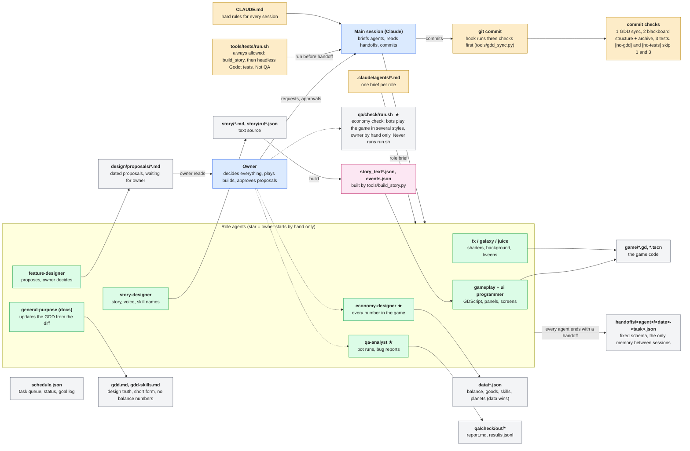

<!-- GENERATED by tools/build_readme.py from tools/readme_intro.md, tools/project_workflow.html and .claude/agents/*.md. Do not edit by hand: change the source and run `python3 tools/build_readme.py`. -->

# Star Bazaar

## ▶ Play now: https://star-bazaar-beta.vercel.app

No install and no account needed.

1. Open the link in a desktop browser (Chrome, Edge, Firefox or Safari with WebGL 2). The first load downloads about 90 MB and takes 10 to 30 seconds.
2. On the main menu click **New Game**. Type a company name (or press **Random**), pick one of the four CEO portraits and press **Start**.
3. Read the short preface. The game then starts paused and a guided tutorial walks you through the first steps: pick a world, place a **Buy** order, **Send to...** another world, run a cycle.
4. Controls are mouse only. **P** pauses. The speed buttons (1x, 2x, 6x, 12x) set how fast cycles run.

Saves are kept in your browser. Assignment write-up (pipeline, integration, cost analysis): [ASSIGNMENT_7.md](ASSIGNMENT_7.md).

## Pipeline audit

Short form of the audit. Full version with tables: [ASSIGNMENT_7.md](ASSIGNMENT_7.md), Deliverable 3.

**What the pipeline produced** (all in the playable build): 3,172 English and 2,961 Russian text ids (events, choices, gigs, endings, skills, tutorial, tips, UI labels). 25 base events, 63 chain events and 40 chain steps, 7 gigs and a 70-node skill tree. 22 goods, 5 workshops and the balance tables. 89 GDScript files (about 32,000 lines). Generated atlases, icons and the ambience track. 264 scheduled tasks (261 done) and 1,014 commits. 84 tasks ran through the unattended orchestrator: 73 merged automatically, 11 were blocked for a human.

**Engine integration:** between agent output and the engine there is **no manual reformatting at all**. Agents write fixed formats (`story/*.md`, `story/ru/*.json`, `data/*.json`, `game/*.gd`). `tools/build_story.py` turns the story files into the JSON the game loads at runtime, and headless Godot imports the generated art. Example, traced end to end: skill *Quartermaster's Terms* went from task T242 to a story-designer run, `story/skills.md`, commit [`a6199564`](https://github.com/Veltrynox/star-bazaar/commit/a6199564b51133c6358de645527f2a742e33a40e), `data/story_text.json` and the skill screen ([screenshot](media/docs/trace_SK_MIL_1_in_game.png)).

**Manual steps that remain.** These are control and release steps, not format steps:
1. The owner approves designs before anything is built.
2. The owner does the visual review in the running game.
3. The owner starts QA and balance runs by hand.
4. The owner settles blocked merges (11 of 84 orchestrator tasks).
5. The owner starts the release (push, web export, Vercel deploy).

They could be removed with a rubric-scored evaluator agent plus screenshot diffs, `qa/check` in CI with fixed thresholds, smaller non-overlapping tasks with an automatic rebuild-and-retry, and a CI export-and-deploy job.

**One architectural change:** most work ran from one long-lived interactive main session on a large model, whose growing context was cached again and again. That session and the agents it started cost $776.77 of $818.54 (95%). The orchestrator's fresh headless workers cost $41.77 for all their tasks, about $0.50 per task. The change: make `schedule.json` plus `tools/orchestrator.py` the only build path, with one short-lived Sonnet or Haiku worker per task that gets only its brief and the files it touches. The interactive session would only talk to the owner and write briefs.

**Cost, before and after.** All figures come from `tools/cost_report.py`, which prices every Claude Code session log at API list rates. Its output is in [`reports/cost_2026-11-25.json`](reports/cost_2026-11-25.json), and [`reports/cost_2026-11-25.csv`](reports/cost_2026-11-25.csv) lists every priced call.

| | Before | After |
|---|---|---|
| Translating the four market event chains to Russian (rule of 2026-11-09) | Sonnet 5.5 story-designer, 4 runs, 71,431 output tokens: **$1.206** | Haiku 5.5 agents, 2 runs, 72,089 output tokens: **$0.074** (−94%) |
| Whole project, API-equivalent (2026-10-28 to 11-25) | | **$818.54** (26,192 calls). Out of pocket: $200 subscription |

The first count, on 2026-11-25, gave $841.07. It still included 2026-10-24 to 10-27, whose logs Claude Code has since deleted under its 30-day retention.

## About

A single-player space trading game made in Godot 4 (GDScript), for macOS and the browser. You run a trading company, not a freighter: ships fly automated routes and you decide where to invest. The goal is to grow your worlds, found the Star Bazaar in a system's Space Storage, raise it stage by stage and open it with a final charter delivery before the term ends. Design truth: [gdd.md](gdd.md). Working rules: [CLAUDE.md](CLAUDE.md).

## Run and test

- Tests (headless): `sh tools/tests/run.sh`
- Economy check (bots in several play styles, headless): `sh qa/check/run.sh`
- Windowed screenshots: `qa/run_game.sh res://qa/gui/<script>.gd`
- Godot lives in `tools/godot/Godot.app` (not in git). Never prefix these commands with `cd &&` or `HOME=`.

## How the work flows

Agents keep no memory between sessions, so everything passes through files. Interactive version: [tools/project_workflow.html](tools/project_workflow.html) (open it in a browser).

## Rules and commit checks

- **Loop:** the owner decides, the main session briefs an agent, the agent changes files and writes a handoff, the main session reads the handoff and commits.
- **Hard rule:** economy-designer and qa-analyst (and the economy check `qa/check/run.sh`, retunes, sign-offs) run only when the owner asks. `sh tools/tests/run.sh` is always allowed and is not QA.
- **Commit gates:** one hook (`tools/gdd_sync.py`) runs three checks on every `git commit`, in this order. A failed check blocks the commit and tells the agent what to fix.
- **1. GDD sync:** `game/`, `data/` or `story/` changed without `gdd.md`. Fix: start doc-manager to update the GDD from the diff, stage it, commit again. No design effect: put `[no-gdd]` in the commit command.
- **2. Blackboard:** `tools/blackboard.py` moves run entries older than the last 4 from `blackboard.md` to `logs/&lt;stamp&gt;-blackboard-archive.md` (disposable, git-ignored; a script, never the agent; the notes are kept). A `blackboard.md` with a bad structure (title, "Do not repeat", "Left to do", run heading, the eight fields in order) blocks the commit.
- **3. Tests:** a commit that changes `game/`, `data/`, `story/` or `tools/tests/` runs `sh tools/tests/run.sh` and is blocked on any FAIL. No code effect: put `[no-tests]` in the commit command.

## Agents

| Agent | Use for |
|---|---|
| economy-designer | Use when Star Bazaar numbers need setting or retuning — prices, margins, trip cost, maintenance, saturation, permits, upgrades, event effects or win/loss thresholds — or when a QA report shows a dominant strategy, an early win or ... |
| feature-designer | Use to think about new Star Bazaar features and to improve existing features and mechanics — find gaps, friction and dull or confusing parts of the game, and propose concrete, costed changes for the owner to approve. Use after a Q... |
| fx-programmer | Use for Star Bazaar planet visual effects only, in Godot 4 shaders and 2D canvas layers: the planet body, parallax cloud layers, atmosphere with refraction and depth, rim light inside and outside the edge, and sun lens effects |
| galaxy-builder | Use for the Star Bazaar galaxy background — generating the star point cloud, baking the 3D density grid, choosing sun points, propagating light through the volume, and the shaders or materials that render it in Godot 4 within the ... |
| gameplay-programmer | Use for any Star Bazaar code task in Godot 4 / GDScript — the core trading loop, ships, automated routes, saturation, permits, upgrades, events, cycle timer, win/loss, tutorial, UI panels, the debug and game-control menus, and the... |
| juice-programmer | Use for Star Bazaar game juice and dynamism in Godot 4 / GDScript: UI tweens and micro-animations, event animations, pop-up and notice animations, number count-ups, screen shake and feedback that keeps the player's attention on th... |
| merge-resolver | Use only when called by tools/orchestrator.py. Mode 1 resolves git rebase conflicts it cannot resolve by its own rules, in one task worktree, keeping both sides' intent. Mode 2 commits uncommitted schedule.json / blackboard.md edi... |
| qa-analyst | Use when the owner asks for the Star Bazaar economy check (qa/check, bots in several play styles) to be run, to report crashes, softlocks, broken endings, unreachable features and dominant strategies. Also use to confirm a reporte... |
| story-designer | Use for the Star Bazaar story and voice: the title and preface screen, event texts, win, loss and ending screens, skill tree names and descriptions, how the learned skills shape the ending, and keeping every text and menu in one c... |
| ui-programmer | Use for Star Bazaar screen and panel work in Godot 4 / GDScript — layout and behaviour of the top bar, planet and route panels, ship panel, cash forecast, skill screen, game menu, notice queue, notification board, dialogs, the pre... |
